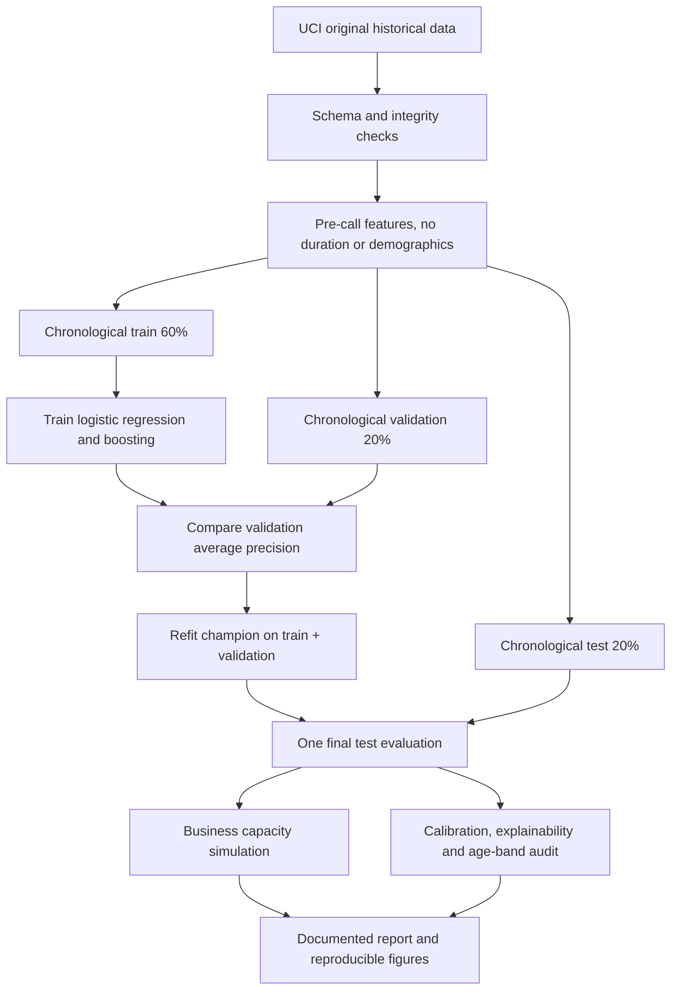
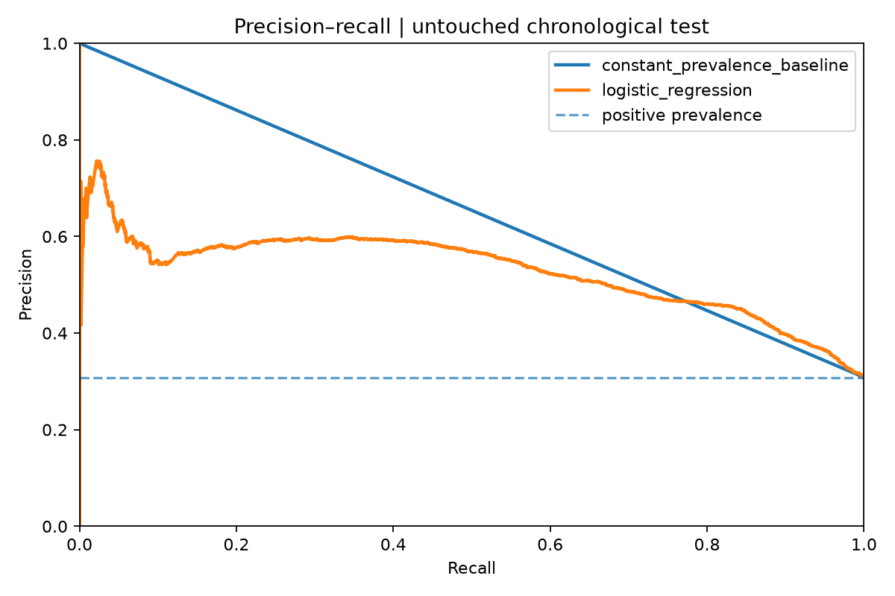
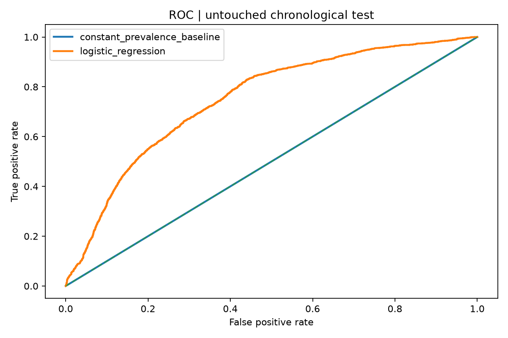
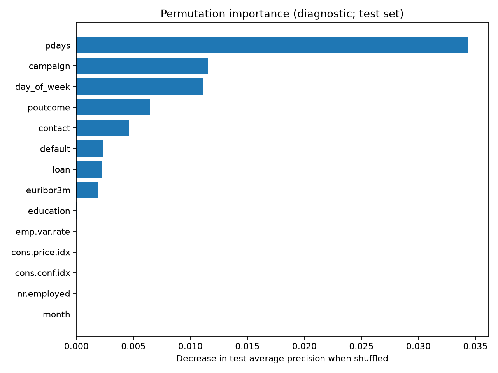

# Bank Marketing Intelligence — End-to-End Machine Learning

**A professional, leakage-aware classification case study built around a realistic commercial decision: who should a banking campaign contact first?**

[](https://github.com/ismaelberja/bank-marketing-ml-portfolio/actions/workflows/tests.yml)

`Python` · `pandas` · `scikit-learn` · `Gradient Boosting` · `Logistic Regression` · `Model Evaluation` · `Explainable ML` · `Business Analytics`

> **Status: COMPLETE — original-data training and reporting verified.** All **41,188** UCI records were downloaded and hash-verified. The complete experiment and automated tests ran successfully on GitHub Actions. Real-data metrics and five diagnostic figures are now published. [View successful experiment](https://github.com/ismaelberja/bank-marketing-ml-portfolio/actions/runs/41493852916) · [Read full experiment report](reports/published/RESULTS.md).

## The business problem

A Portuguese banking institution historically used telephone marketing campaigns to promote term deposits. If a team can contact only a fraction of its available records, which ones should it prioritize? Instead of chasing overall accuracy, this project explicitly evaluates **the quality of subscription ranking under a fixed campaign capacity**.

**Goal:** rank historically contacted records by predicted term-deposit subscription, using only features plausibly available **before** a telephone call. No individual financial or eligibility decisions are performed.

## Why this is more than a model tutorial

| Area | Implementation |
|---|---|
| Realistic problem framing | Capacity-constrained marketing outreach and explicitly hypothetical call economics |
| Data provenance | Original UCI dataset, pinned experiment metadata, CSV SHA-256, CC BY 4.0 attribution |
| Leakage prevention | **Never use `duration`**; exclude `age` and `marital` from the predictors |
| Temporal validation | Chronological 60/20/20 split; model selection **only on validation** |
| Reproducible modeling | Training-only preprocessing with `ColumnTransformer` + `Pipeline` |
| Models | Logistic regression and histogram gradient boosting, plus a prevalence-only baseline |
| Imbalance-aware metrics | Average precision, ROC AUC, Brier score, precision/recall/lift at contact capacity |
| Decision support | Top 20% targeting simulation with editable hypothetical conversion value and call cost |
| Interpretability | Permutation importance for the selected model; diagnostics, not causal claims |
| Model governance | Group-level age audit, calibration diagnostics, documented limitations |
| Engineering | Typed Python modules, CLI, 9 automated tests, CI workflow, reproducible report generation |

## Dataset and attribution

Source: [**UCI Machine Learning Repository — Bank Marketing**](https://archive.ics.uci.edu/dataset/222/bank+marketing), by **Moro, Rita and Cortez (2014)**, DOI [10.24432/C5K306](https://doi.org/10.24432/C5K306), **CC BY 4.0**.

- Original selected file: **`bank-additional-full.csv`**, **41,188** time-ordered records (2008–2010), 20 original predictors and a binary label `y`.
- Subscription label: `yes` or `no`.
- The dataset is observational, historical and includes only records of actual calls; it cannot measure causal campaign uplift.
- Original CSV is downloaded directly from UCI and **excluded from version control**.

## A decision that changes the model: no post-call leakage

The source contains a feature called `duration`, describing how long a phone call lasted. It is highly predictive of subscription **but could never be available at the moment the team chooses whom to call**. Using it for this business problem would make test performance misleading. This project explicitly removes `duration` from **all** model inputs and tests that exclusion automatically.

Similarly, `age` and `marital` are not used for model scoring; `age` is used only for aggregated diagnostic group comparisons. Other features may still act as demographic proxies and require careful review.

## End-to-end workflow



## Quick start

**Prerequisites:** Python 3.11+ and an internet connection to fetch the public dataset once.

```bash
# 1. Clone the repository and install dependencies
git clone https://github.com/ismaelberja/bank-marketing-ml-portfolio.git
cd bank-marketing-ml-portfolio
python -m pip install -e '.[dev]'

# 2. Download original CSV from UCI
python -m bankml.download

# 3. Run all tests (tests deliberately use synthetic fixtures)
python -m pytest -q

# 4. Train on real UCI data and generate the complete evaluation
python -m bankml.train --data data/raw/bank-additional-full.csv --output reports/published
```

On Windows, use `py` instead of `python` if necessary. Typical output after a successful real run:

```text
reports/published/
  RESULTS.md                    # Actual observed metrics and careful interpretations
  experiment.json               # Hash, feature policy, split, model and metrics
  figures/precision_recall.png
  figures/roc.png
  figures/calibration.png
  figures/contact_matrix.png
  figures/permutation_importance.png
models/champion.joblib          # Local only; NEVER committed
```

### Automatic real-data run on GitHub

A separate workflow, [**Train models and publish verified UCI results**](.github/workflows/publish-results.yml), can be run manually from GitHub Actions. It installs dependencies, runs all nine tests, downloads the *original* data from UCI, computes models and commits **aggregate reports/plots only**. It does **not** publish raw client-level rows or the local model file.

## Verified experiment results

The experiments below have **actually been executed on the original 41,188-row UCI dataset**, with a chronological 60/20/20 split, no call-duration predictor and an untouched final test sample.

| Verified metric | Result |
|---|---:|
| Selected model | **Logistic regression** (selected by validation average precision) |
| Held-out test records | **8,238** |
| Positive class prevalence (test) | **30.83%** |
| Test average precision | **0.529** |
| Test ROC AUC | **0.749** |
| Test Brier score | **0.191** |
| Precision among the top 20% of records | **59.4%** |
| Lift at 20% capacity versus test prevalence | **1.93×** |
| Subscriptions within the 1,647 highest-ranked historical records | **979** |

### What the results mean

Under this historical test split, the model ranks observed subscriptions more effectively than a constant-score baseline. A hypothetical campaign contacting 20% of records would have included 979 historical subscribers among 1,647 selected records. **This is retrospective ranking, not causal lift or measured profit.**

**Important limitation:** class prevalence rises from **4.81% in training** to **11.07% in validation** and **30.83% in the final test**. Validation average precision was only **0.099**, below validation prevalence, and ROC AUC was **0.490**. This large temporal drift means the final test results should **not** be interpreted as stable out-of-time performance or a deployable banking model. The project documents this limitation instead of hiding the inconvenient result.

### Diagnostic figures







[Calibration plot](reports/published/figures/calibration.png) · [Campaign selection matrix](reports/published/figures/contact_matrix.png)

### Reproducible experiment artifacts

See:

- [Real-data model comparison and business findings](reports/published/RESULTS.md)
- [Machine-readable experiment manifest](reports/published/experiment.json)
- [Five generated charts](reports/published/figures/)

The documented output covers held-out average precision, ROC AUC, Brier score, test prevalence, precision at limited campaign capacity, lift, group diagnostics and permutation importance. The financial scenario uses **hypothetical assumptions (€100 value per conversion, €5 per call)**, *not* historical bank revenue or real incremental profit.

## Model and ethical limitations

- **Not a production decision system.** The observations reflect one Portuguese institution between **2008 and 2010**; modern results and generalization cannot be assumed.
- **Time-aware split is approximate.** The UCI full file is provided in chronological row order, but full timestamps and persistent client IDs are unavailable. True person-level grouping and rigorous rolling-window validation cannot be implemented from this data alone.
- **Observational selection bias.** Every row is a historical contacted record. There is no randomized untreated group, so the simulation is **not a causal uplift study**.
- **Correlation ≠ causation.** Permutation importance and difference in performance across subgroups do not identify causal mechanisms.
- **Responsible prediction.** Macro-economic and occupational variables can shift and act as demographic proxies. A live campaign would require consent, data governance, fairness audits, calibration monitoring and controlled experimentation.

Read the full [model card](docs/MODEL_CARD.md) and [engineering decisions](docs/ENGINEERING.md).

## Repository structure

```text
bankml/
  data.py             # Dataset contract, feature policy, chronological splits
  download.py         # Official UCI data acquisition and row-count verification
  train.py            # Pipelines, validation selection, final holdout, reporting
  metrics.py          # Business ranking, lift, monetary scenario, group audit
  plots.py            # 5 reproducible evaluation visualizations
  predict.py          # Local scoring of already authorized input data
  fixtures.py         # Clearly synthetic fixture for tests ONLY
tests/test_pipeline.py
.github/workflows/
  tests.yml           # Unit + synthetic end-to-end checks
  publish-results.yml # Explicit real UCI run and aggregate-results publication
docs/
  MODEL_CARD.md
  ENGINEERING.md
pyproject.toml
```

## AI assistance and project ownership

This portfolio was assembled with AI coding assistance. Its purpose is to demonstrate a transparent, technically reviewable end-to-end workflow. The owner should run the code, inspect the test results, understand the assumptions and make independently reviewed improvements before describing the work as solely self-developed.

---

**Portfolio: Ismael Berja Ruiz** · Physics / Astrophysics · Python / Data Science
