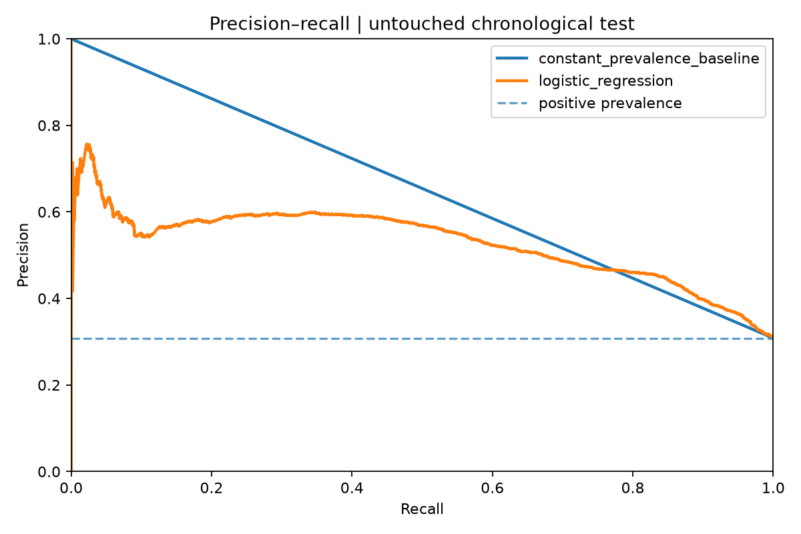
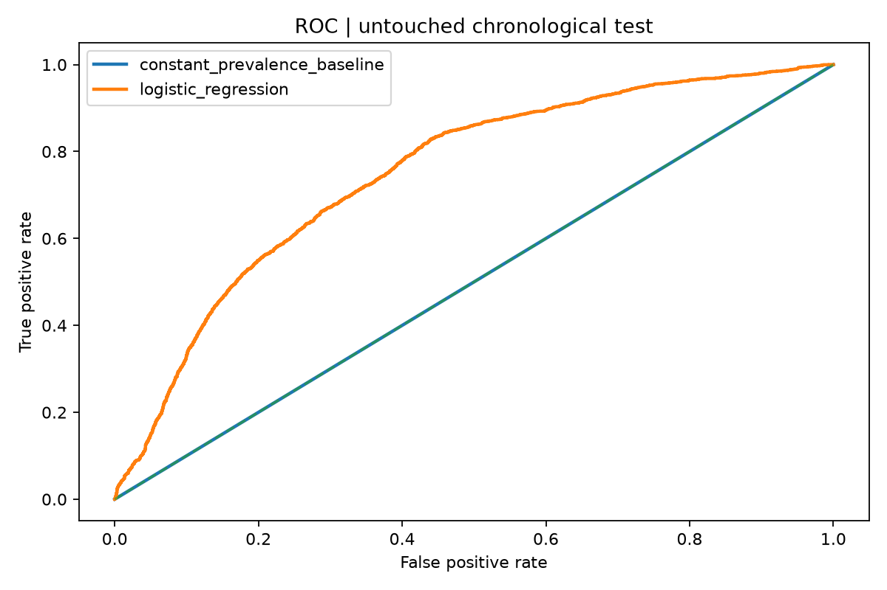
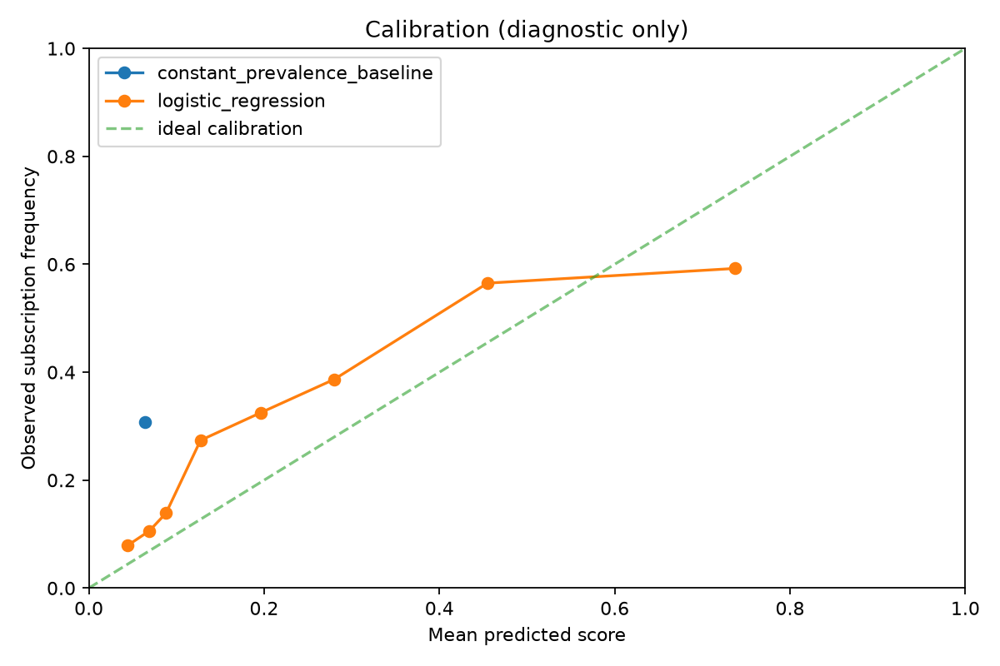
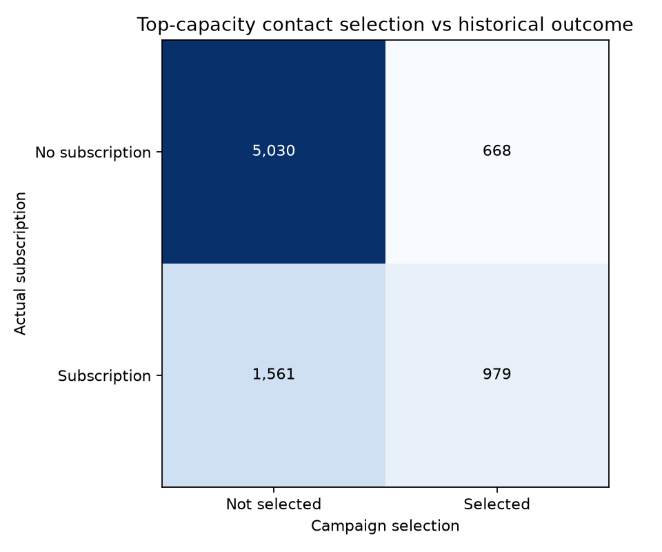
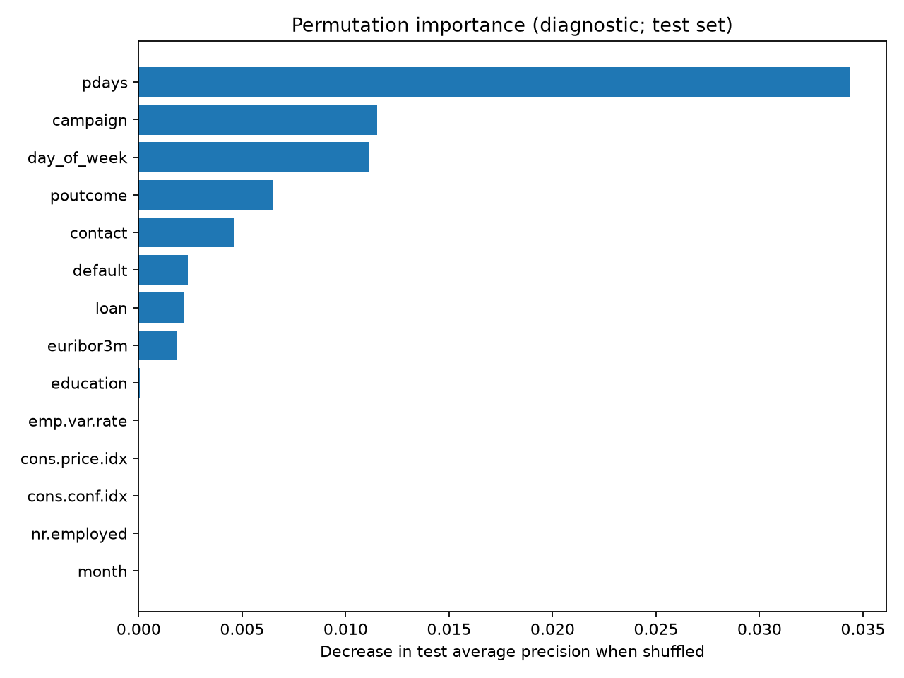

# Bank Marketing ML — Experiment report

> **ORIGINAL DATA** — 41,188 records verified against the SHA-256 manifest saved by the original-source downloader.

## Executive summary

- **Business question:** among historically contacted customers, can we rank likely deposit subscriptions before a call?
- **Selected model:** `logistic_regression`, selected solely using validation-set average precision.
- **Held-out period:** last **20%** of chronologically ordered observations (row order is a date proxy).
- **Test average precision:** 0.529; **ROC AUC:** 0.749.
- **Test precision at 20% capacity:** 59.4%; **lift vs test prevalence:** 1.93x.
- **Scenario-only incremental value vs random ranking:** €47,118, not an observed profit or a causal impact estimate.

## Dataset and split

| Split (original chronological order) | Records | Positive target rate |
|---|---:|---:|
| Train | 24,712 | 4.81% |
| Validation | 8,238 | 11.07% |
| Test | 8,238 | 30.83% |

## Model comparison — untouched test

| Model | Average precision | ROC AUC | Brier score | Precision @ capacity | Lift @ capacity |
|---|---:|---:|---:|---:|---:|
| constant_prevalence_baseline | 0.308 | 0.500 | 0.273 | n/a | n/a |
| logistic_regression | 0.529 | 0.749 | 0.191 | 59.4% | 1.93x |

**Baseline note:** a constant prior score cannot rank records; top-capacity precision and lift are not defined for this baseline.

## Campaign simulation

- **Contact capacity:** top 20% of the test records ranked by score.
- **Hypothetical value per observed subscription:** €100.
- **Hypothetical cost per contact:** €5.
- **Contacts selected:** 1,647.
- **Subscriptions within selected rows:** 979.
- **Recall of historical subscribers:** 38.5%.
- **Simulated net value for selected rows:** €89,665.

**Warning:** all records were contacted historically; this retrospective exercise cannot tell us what would have happened to customers who were never contacted. The hypothetical financial values are user-configurable assumptions and not bank revenue data.

## Model selection protocol

- Data are contiguous: first 60% train, next 20% validation, final 20% test.
- Candidate choice uses **validation average precision only**, never test scores.
- Selected model is refit on train+validation before the final, one-off test evaluation.
- Preprocessing is learned only on each fitting fold; unseen categories are ignored safely.
- Target leakage: **`duration` excluded** (unknown until a call finishes).
- Demographic fields **`age` and `marital` excluded** from prediction; age used for aggregate audit only.
- Monthly economic indicators and other features may act as time proxies; concept drift is expected.

## Validation-only comparison

| Model | Validation average precision | Validation ROC AUC |
|---|---:|---:|
| logistic_regression | 0.099 | 0.490 |
| gradient_boosting | 0.093 | 0.426 |

## Aggregate age-band audit (test; descriptive)

| Age band | N | Actual positive rate | Selection rate | TPR | FPR | Precision |
|---|---:|---:|---:|---:|---:|---:|
| 18-35 | 4050 | 28.6% | 17.8% | 37.4% | 10.0% | 60.1% |
| 36-55 | 2946 | 28.9% | 17.1% | 34.7% | 9.9% | 58.8% |
| 56+ | 1237 | 42.8% | 34.0% | 47.1% | 24.2% | 59.3% |

**Not a fairness certification.** Age groups may differ in contact history, outcome prevalence and sample size. Report only aggregate results.

## Model interpretation

Permutation importance measures the loss in **test average precision** when one input feature is shuffled. It indicates predictive reliance, **not causality**.

| Feature | Mean decrease in average precision |
|---|---:|
| pdays | 0.0344 |
| campaign | 0.0115 |
| day_of_week | 0.0111 |
| poutcome | 0.0065 |
| contact | 0.0046 |
| default | 0.0024 |
| loan | 0.0022 |
| euribor3m | 0.0019 |
| education | 0.0001 |
| emp.var.rate | 0.0000 |
| cons.price.idx | 0.0000 |
| cons.conf.idx | 0.0000 |

## Reproducible figures

## Limitations and responsible use

- Data: Portuguese bank telemarketing from **2008–2010**, not a modern deployment population.
- UCI documents row order as chronological, but exact timestamps and customer IDs are unavailable.
- Repeat observations by the same person cannot be ruled out and group leakage cannot be tested.
- Selection / calibration may shift over time. These are observational, historical associations.
- Job, education and financial predictors may be demographic proxies and require governance.
- No production deployment, lending/eligibility decision or automatic customer targeting is advised.
- Reported experiments were developed with AI coding assistance; interpretation and ownership require review.

## Provenance and verification

- Source: [UCI Bank Marketing, DOI 10.24432/C5K306](https://archive.ics.uci.edu/dataset/222/bank+marketing).
- Dataset license: CC BY 4.0. Original data are not redistributed here.
- SHA256 of source CSV: `74adfc578bf77a7ff4bb1ba4a9f8709d9e3c6907342959c2c8416847e0afb4d8`.
- See `experiment.json` for machine-readable settings and results.
